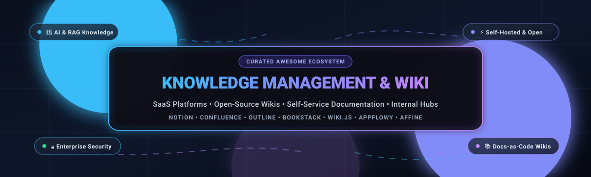
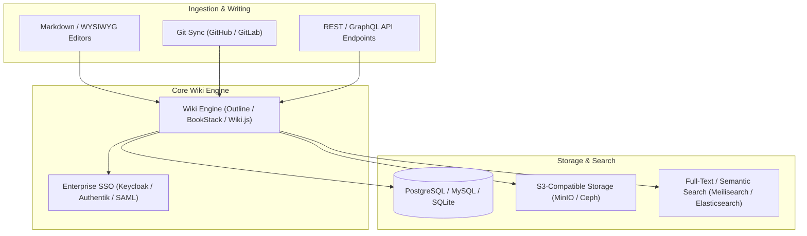

  

# 🚀 Awesome Knowledge Management & Self-Service Wiki 

> 🌟 A curated directory of the best **Knowledge Management Systems (KMS)**, **Internal Team Wikis**, **Self-Service Customer Knowledge Bases**, and **Docs-as-Code** platforms. Spanning leading SaaS software and self-hosted open-source GitHub alternatives.

  
  
  
  
  
  

---

## 📌 Table of Contents

- [📊 Sector Overview & Market Dynamics](#-sector-overview--market-dynamics)
- [☁️ SaaS & Hosted Knowledge Platforms](#️-saas--hosted-knowledge-platforms)
- [🛠️ Open-Source & Self-Hosted Wiki Solutions](#️-open-source--self-hosted-wiki-solutions)
  - [⭐ Open-Source Comparison & Star Ranking](#-open-source-comparison--star-ranking)
  - [🔍 Categorized Open-Source Deep Dive](#-categorized-open-source-deep-dive)
- [🏛️ Core Architectural Stacks](#️-core-architectural-stacks)
- [⚖️ How to Choose: SaaS vs. Self-Hosted](#️-how-to-choose-saas-vs-self-hosted)
- [🤝 How to Contribute](#-how-to-contribute)
- [⭐ Star History](#-star-history)
- [💖 Support](#-support)
- [📄 Disclaimer](#-disclaimer)

---

## 📊 Sector Overview & Market Dynamics

The global **Knowledge Management Software (KMS)** market was valued at approximately **$17.15B to $20.1B in 2024–2025** and is projected to expand at a compound annual growth rate (**CAGR**) of **13.6% to 18.3%**, surpassing **$60B+ by the mid-2030s**, propelled by enterprise adoption of Generative AI, Retrieval-Augmented Generation (RAG), and unified semantic workplace search.

The sector is **highly fragmented** rather than a winner-take-all monopoly: enterprise conglomerates (Microsoft 365/Viva, Atlassian, ServiceNow) command wide collaborative footprints, while specialized vertical SaaS solutions (Helpjuice, Document360, GitBook, Guru) capture dedicated customer-support and developer-documentation niches alongside a rapidly growing ecosystem of privacy-first, local-first open-source alternatives.

---

## ☁️ SaaS & Hosted Knowledge Platforms

The table below catalogs premier commercial SaaS knowledge management platforms, sorted descending by company size (valuation / annual revenue).

| 🏢 Product | 📈 Company Scale / Valuation / Revenue | 💳 Starting Tier Pricing | 🎁 Free Tier Limits / Free Trial Limits | 💡 Primary Use Case & Key Highlights |
| :--- | :--- | :--- | :--- | :--- |
| **[Atlassian Confluence](https://www.atlassian.com/software/confluence)** | **~$42B–$63B Market Cap** *(Public: NASDAQ: TEAM, ~$4.4B ARR)* | **$6.05 / user / month** (Standard plan) | **Free Forever:** Up to 10 users, 2 GB file storage, unlimited spaces and pages, community support | Enterprise-grade structured team workspace with deep Jira/DevOps integration, page permissions, and Confluence Whiteboards. |
| **[Zoho Learn / KB](https://www.zoho.com/learn/)** | **~$12.4B–$15B Valuation** *(Bootstrapped, ~$1.5B Revenue)* | **$1.00 / user / month** (Express plan, billed annually) | **Free Forever:** Up to 5 users, 3 spaces, 5 manuals, 5 courses, 1 GB storage limit | Unified company wiki and learning management system (LMS); articles, interactive runbooks, and staff training modules. |
| **[Notion](https://www.notion.so/)** | **$11.0B Valuation** *(Private, ~$600M ARR)* | **$10.00 / user / month** ($8 billed annually, Plus plan) | **Free Forever:** Unlimited blocks for individuals (limited block trial for 2+ members), up to 10 guest collaborators, 5 MB file upload limit | Modular flexible block workspace integrating docs, wikis, relational databases, kanban boards, and native AI workplace assistants. |
| **[Guru](https://www.getguru.com/)** | **~$222M Valuation** *(Raised $70M, ~$63M ARR)* | **$15.00 / user / month** ($18 billed monthly, 10-seat min) | **Free Trial Only:** 30-day free trial with full feature access; no permanent free plan | AI-powered enterprise search and in-workflow verified knowledge cards with Slack, MS Teams, and browser extension overlays. |
| **[Document360](https://document360.com/)** | **~$100M Valuation** *(Kovai.co, ~$10M+ ARR, Bootstrapped)* | **$149.00 / project / month** (Base tier, annual billing) | **Free Trial Only:** 14-day full-featured free trial; custom quote / contract required thereafter | Dedicated internal and customer-facing documentation portals featuring Eddy AI, markdown/WYSIWYG editors, and multi-versioning. |
| **[Bloomfire](https://bloomfire.com/)** | **~$50M–$100M Valuation** *(Primus Capital, ~$10M ARR)* | **$500.00 / month** (Entry team tier, billed annually) | **Free Trial Only:** No self-serve free trial; custom walkthrough and 14-day assisted pilot available upon request | Enterprise knowledge engagement platform indexing videos, audio, and multimedia documentation with automated transcription. |
| **[Slite](https://slite.com/)** | **~$30M–$50M Valuation** *(Raised $15.5M, ~$4.5M ARR)* | **$10.00 / user / month** ($12 billed monthly, Basic plan) | **Free Trial Only:** 14-day free trial with 500 pooled AI credits; no permanent free plan | Clean, distraction-free collaborative internal wiki designed for remote and asynchronous teams with automated doc verification. |
| **[GitBook](https://www.gitbook.com/)** | **~$30M–$50M Valuation** *(Bootstrapped/PLG, ~$4M ARR)* | **$65.00 / site / month** ($79 billed monthly, Essential plan) | **Free Forever:** 1 user (solo/open-source), `gitbook.io` subdomain, unlimited public traffic, native Git sync | Modern docs-as-code platform supporting Git synchronization (GitHub/GitLab), markdown, OpenAPI/Swagger specifications, and MCP tools. |
| **[Helpjuice](https://helpjuice.com/)** | **~$20M–$30M Valuation** *(Bootstrapped, ~$4M ARR)* | **$249.00 / month** (Up to 30 users, Starter tier) | **Free Trial Only:** 14-day free trial with all features and custom styling support included; no permanent free plan | High-performance customer support knowledge base with instant search algorithms, multi-language localization, and customized branding. |
| **[Slab](https://slab.com/)** | **~$15M–$25M Valuation** *(Raised $2.2M, ~$3M ARR)* | **$6.67 / user / month** ($8 billed monthly, Startup plan) | **Free Forever:** Up to 10 users, 3 guests per user, 10 MB per attachment, 90-day version history, unlimited posts | Modern knowledge hub featuring unified search across external tools (Slack, Google Drive, GitHub) and minimalist writing UX. |

---

## 🛠️ Open-Source & Self-Hosted Wiki Solutions

Self-hosting gives engineering, DevOps, and security teams total data ownership, local air-gapped security, zero vendor lock-in, and custom regulatory compliance (GDPR, HIPAA, SOC 2).

### ⭐ Open-Source Comparison & Star Ranking

All repositories below feature live GitHub star metrics (styled with `style=social&color=white`) sorted in descending order of popularity.

| 📦 Repository & Stargazers | ⭐ GitHub Stars Badge | 💻 Primary Language | 📜 License | ✨ Highlights & Architecture |
| :--- | :--- | :--- | :--- | :--- |
| **[AppFlowy](https://github.com/AppFlowy-IO/AppFlowy)** |  | Flutter / Rust | AGPL-3.0 | Modern open-source Notion alternative; local-first data ownership, offline-native support, and collaborative workspaces. |
| **[AFFiNE](https://github.com/toeverything/AFFiNE)** |  | TypeScript / Rust | MIT | Next-generation multimodal workspace unifying structured docs, infinite digital whiteboards, and relational tables. |
| **[Memos](https://github.com/usememos/memos)** |  | Go / TypeScript | MIT | Privacy-first, lightweight self-hosted micro-knowledge garden and memo timeline for team or personal notes. |
| **[Logseq](https://github.com/logseq/logseq)** |  | Clojure / TypeScript | AGPL-3.0 | Privacy-first, local-first outliner and graph-based personal knowledge management (PKM) tool powered by plain text. |
| **[Outline](https://github.com/outline/outline)** |  | TypeScript / React | BSL-1.1 | Blazing fast, beautiful team knowledge base with real-time markdown collaboration, Slack integrations, and SSO. |
| **[Trilium Notes](https://github.com/zadam/trilium)** |  | JavaScript | AGPL-3.0 | Hierarchical note-taking knowledge engine with deep tree organization, encrypted notes, and rich script execution. |
| **[Wiki.js](https://github.com/requarks/wiki)** |  | JavaScript / Vue | AGPL-3.0 | Modern, modular wiki engine with Markdown, WYSIWYG, multi-database backends, and bidirectional Git repository synchronization. |
| **[Docmost](https://github.com/docmost/docmost)** |  | TypeScript / NestJS | AGPL-3.0 | Modern real-time collaborative wiki and documentation software; lightweight open-source alternative to Confluence and Notion. |
| **[BookStack](https://github.com/BookStackApp/BookStack)** |  | PHP / Laravel | MIT | Opinionated organizational hierarchy structured into Shelves → Books → Chapters → Pages; intuitive for non-technical users. |
| **[Etherpad](https://github.com/ether/etherpad-lite)** |  | JavaScript | Apache-2.0 | Battle-tested collaborative real-time rich-text editing engine designed for instantaneous knowledge drafting and team pads. |
| **[Foam](https://github.com/foambubble/foam)** |  | TypeScript | MIT | Roam Research-like personal knowledge management and networked thought workspace built natively on Visual Studio Code. |
| **[Gollum](https://github.com/gollum/gollum)** |  | Ruby | MIT | Simple, lightweight Git-backed wiki engine powering local repositories and standard web frontends across multiple markup types. |
| **[TiddlyWiki5](https://github.com/TiddlyWiki/TiddlyWiki5)** |  | JavaScript | BSD-3-Clause | Non-linear, interactive personal knowledge notebook executable as a single self-contained HTML file or Node.js server. |
| **[HedgeDoc](https://github.com/hedgedoc/hedgedoc)** |  | TypeScript | AGPL-3.0 | Real-time collaborative Markdown editor (formerly CodiMD); ideal for engineering meeting notes, specs, and live sprint wikis. |
| **[Dendron](https://github.com/dendronhq/dendron)** |  | TypeScript | AGPL-3.0 | Hierarchical, schema-backed markdown note-taking tool built on top of VS Code to manage massive knowledge bases. |
| **[Standard Notes](https://github.com/standardnotes/app)** |  | TypeScript | AGPL-3.0 | End-to-end encrypted knowledge sanctuary for confidential organizational records, architectural designs, and secrets. |
| **[SilverBullet](https://github.com/silverbulletmd/silverbullet)** |  | TypeScript | MIT | Extensible, malleable markdown note-taking and knowledge system with Lua scripting and query language over text blocks. |
| **[MediaWiki](https://github.com/wikimedia/mediawiki)** |  | PHP | GPL-2.0 | The legendary wiki engine powering Wikipedia; extreme scalability, enterprise version history, and vast extension ecosystem. |
| **[DokuWiki](https://github.com/dokuwiki/dokuwiki)** |  | PHP | GPL-2.0 | Ultra-reliable file-based wiki requiring zero SQL databases; plain text files make manual backups, git tracking, and restoration trivial. |
| **[TriliumNext](https://github.com/TriliumNext/Notes)** |  | JavaScript | AGPL-3.0 | Active community continuation fork of Trilium Notes, adding modern security patches, UI enhancements, and responsive layouts. |
| **[XWiki Platform](https://github.com/xwiki/xwiki-platform)** |  | Java | LGPL-2.1 | Industrial enterprise wiki platform with relational data modeling, granular document permissions, and custom scriptable macros. |

---

### 🔍 Categorized Open-Source Deep Dive

#### 1. 🌐 Modern Team Wikis & Knowledge Workspaces
- **[AppFlowy](https://github.com/AppFlowy-IO/AppFlowy)**  — Built with Flutter and Rust, AppFlowy offers native desktop/mobile apps and self-hosted cloud sync with complete privacy.
- **[AFFiNE](https://github.com/toeverything/AFFiNE)**  — Unifies brainstorming whiteboards, structured docs, and kanban/table data in one canvas.
- **[Outline](https://github.com/outline/outline)**  — The premier open-source Confluence/Notion alternative for high-growth tech teams. Integrates with Slack, Google Workspace, and OIDC/SAML.
- **[Docmost](https://github.com/docmost/docmost)**  — Clean, modern document editor supporting multiplayer collaboration, nested page trees, and lightweight container deployments.

#### 2. 📚 Structured Organizational Handbooks & Docs
- **[BookStack](https://github.com/BookStackApp/BookStack)**  — Uses a familiar "Book / Chapter / Page" mental model. Features built-in diagramming (draw.io), multi-factor authentication, and LDAP/SAML support.
- **[Wiki.js](https://github.com/requarks/wiki)**  — Highly customizable Node.js wiki supporting PostgreSQL, MySQL, SQLite, and bidirectional Git commits for automated revision backups.

#### 3. 🧠 Networked Thought & Personal Knowledge Management (PKM)
- **[Logseq](https://github.com/logseq/logseq)**  — Outliner supporting bi-directional linking, query-based workflows, flashcards, and local Markdown/Org-mode files.
- **[Memos](https://github.com/usememos/memos)**  — Micro-blogging and fleeting knowledge capture engine with RESTful APIs, SQLite storage, and tags.
- **[Foam](https://github.com/foambubble/foam)**  — Transforms VS Code into a personal thinking workspace using standard Markdown files and wiki-style link graphs.
- **[SilverBullet](https://github.com/silverbulletmd/silverbullet)**  — An open, hackable knowledge notebook where pages can be queried like a database using embedded expressions.

#### 4. 🏛️ Enterprise & Classic Wiki Engines
- **[MediaWiki](https://github.com/wikimedia/mediawiki)**  — The gold standard for massive encyclopedic knowledge, complex category taxonomies, and multi-language enterprise wikis.
- **[XWiki](https://github.com/xwiki/xwiki-platform)**  — Enterprise Java-based wiki system featuring structured data entry, programmable macro engines, and Confluence migration tools.
- **[DokuWiki](https://github.com/dokuwiki/dokuwiki)**  — Flat-file database-free architecture ensures rapid deployment on shared hosting or lightweight containers.

---

## 🏛️ Core Architectural Stacks

When architecting a production-grade internal knowledge base, common self-hosted blueprints include:

---

## ⚖️ How to Choose: SaaS vs. Self-Hosted

| 📐 Decision Criterion | ☁️ Hosted SaaS (Notion, Confluence, Helpjuice) | 🖥️ Self-Hosted Open Source (Outline, BookStack, Wiki.js) |
| :--- | :--- | :--- |
| **🚀 Deployment Time** | Instant onboarding; zero server setup | Requires Docker, Kubernetes, or cloud VM provisioning |
| **🔒 Data Governance** | Vendor-managed multi-tenant cloud | 100% on-premises / air-gapped data residency compliance |
| **🛠️ Maintenance Burden** | Zero maintenance; automatic security updates | Requires sysadmin updates, database backups, and SSL renewals |
| **💰 Cost Predictability** | Scales per user/month; can get expensive for large teams | Fixed infrastructure compute cost; completely free software licenses |
| **🤖 Search & AI** | Integrated managed RAG and turnkey AI assistants | Requires integrating local LLMs or third-party vector/search engines |

---

## 🤝 How to Contribute

Contributions are welcome! Please follow these steps to add or update entries:

1. 🍴 Fork this repository.
2. 🌿 Create a feature branch (`git checkout -b feature/add-new-wiki`).
3. 📝 Add entries to `README.md` keeping the tables sorted:
   - **SaaS Table**: Sorted descending by company valuation / revenue.
   - **Open-Source Table**: Sorted descending by GitHub star count with badges linked to stargazers.
4. ✅ Verify all links and pricing details.
5. 🚀 Commit your changes and submit a pull request!

---

## ⭐ Star History

---

## 💖 Support

Thank you for visiting and using this curated directory! If you found this repository helpful, please consider:
- ⭐ **Starring** the repository to show your appreciation!
- 🍴 **Forking** it to keep a personal copy or contribute improvements.
- 📢 **Sharing** it with friends, colleagues, and engineering communities.
- ☕ **Buying a coffee / sponsoring** the maintainer via the [GitHub Sponsors Dashboard](https://github.com/sponsors/ishandutta2007).

Your support keeps this knowledge-sharing ecosystem thriving! 🙌

---

## 📄 Disclaimer

- This repository is a community-curated collection for educational and architectural evaluation purposes.
- Valuations, revenues, and pricing tiers reflect published market research, venture disclosures, and public pricing tiers as of late 2025/2026 and are subject to change.
- Ensure appropriate data classification, access control policies, and automated snapshot backups are configured before migrating internal company documents to any knowledge base platform.
